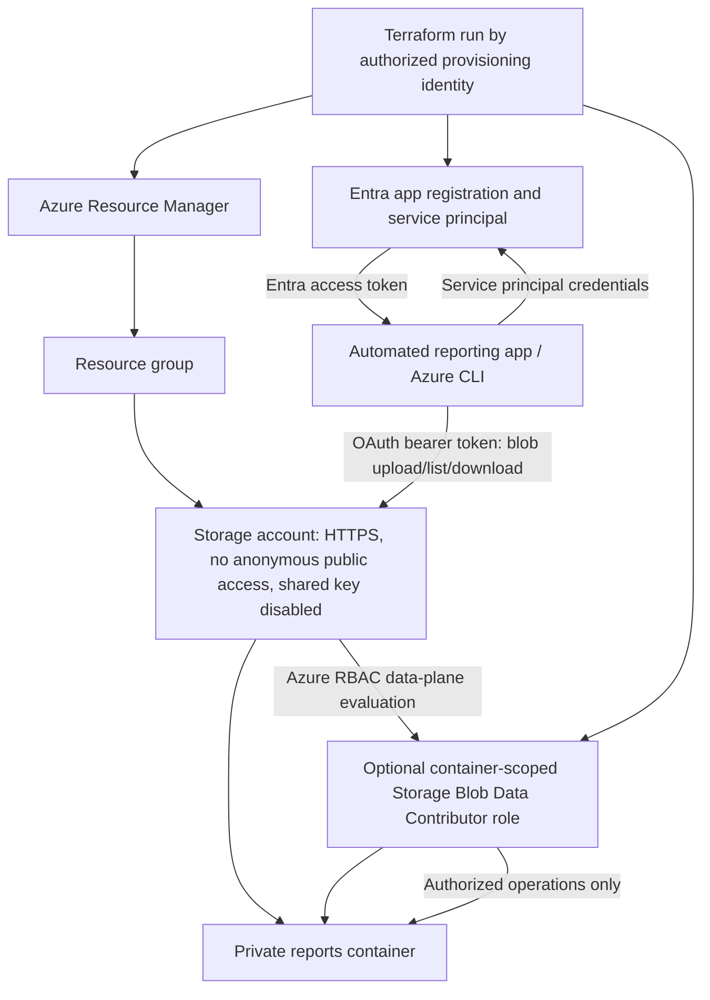

# Architecture — identity and authorization flow

**Trust boundaries:** Entra authenticates the application; Azure Storage enforces data-plane authorization based on RBAC. The provisioning identity needs broader deployment permissions than the runtime service principal. Runtime access is scoped to one container. A managed identity or workload identity federation is preferable for production where supported.
